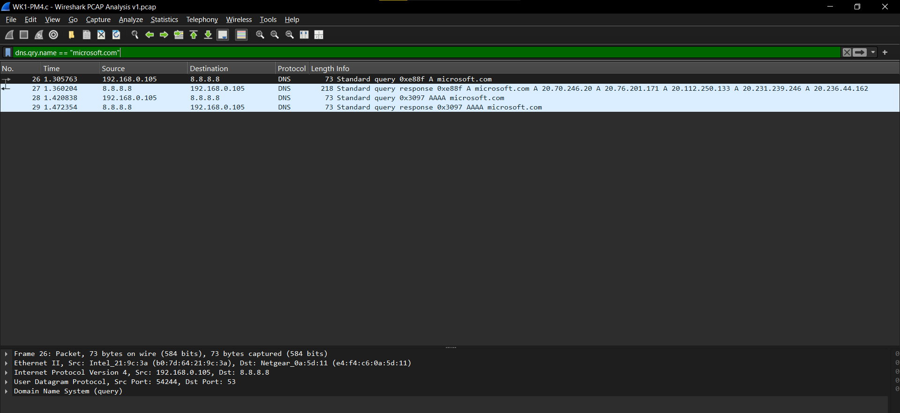
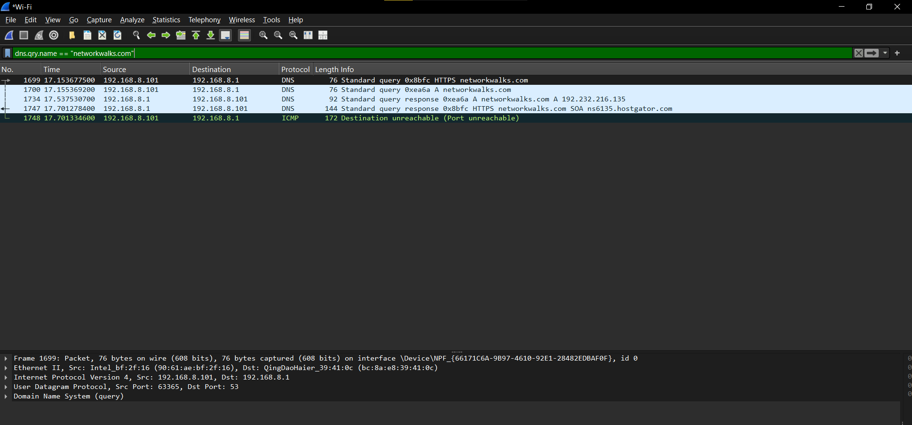

# Wireshark PCAP Analysis Report

DNS query and TLS connection analysis of two network captures:

| Domain | Client IP | DNS Server | Resolved IP(s) | Port | TLS |
|--------|-----------|------------|----------------|------|-----|
| **microsoft.com** | 192.168.0.105 | 8.8.8.8 | 20.70.246.20, 20.76.201.171, 20.112.250.133, 20.231.239.246, 20.236.44.162 | 443 | TLSv1.3 |
| **networkwalks.com** | 192.168.8.101 | 192.168.8.1 | 192.232.216.135 | 443 | TLSv1.3 |

## Contents

```
├── Wireshark_PCAP_Analysis_Report.docx   # Full formatted report (with screenshots)
├── screenshots/
│   ├── microsoft-com-capture.png         # Wireshark filter: dns.qry.name == "microsoft.com"
│   └── networkwalks-com-capture.png      # Wireshark filter: dns.qry.name == "networkwalks.com"
└── README.md
```

## Report Summary

### 1. microsoft.com
- **Laptop IP:** `192.168.0.105`
- **DNS Server:** `8.8.8.8` (Google Public DNS)
- **Queries:** A (IPv4) and AAAA (IPv6)
- **Response:** Five A records returned
- **HTTPS:** Port 443, TLSv1.3

### 2. networkwalks.com
- **Laptop IP:** `192.168.8.101`
- **DNS Server / Gateway:** `192.168.8.1`
- **Queries:** HTTPS and A (IPv4)
- **Response:** Single A record → `192.232.216.135`
- **Extra:** ICMP Destination unreachable (Port unreachable)
- **HTTPS:** Port 443, TLSv1.3

## Screenshots

### microsoft.com DNS capture


### networkwalks.com DNS capture


## How to open

- Open `Wireshark_PCAP_Analysis_Report.docx` in Microsoft Word, Google Docs, or LibreOffice Writer.
- Screenshots are also available as standalone PNG files in the `screenshots/` folder.
